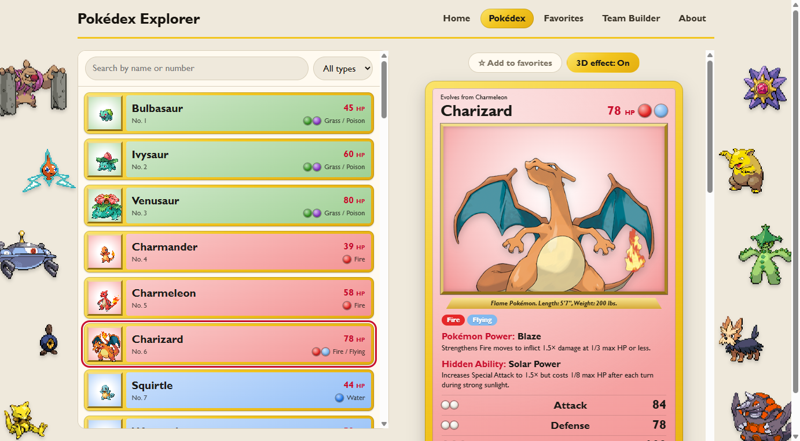

# Pokédex Explorer

Browse all 649 Pokémon from Generations 1–5, styled like the original Pokémon trading cards.

**Live site: https://illyy1.github.io/pokedex-explorer/**



## Features

- **Pokédex:** search by name or number, filter by type, and scroll through every Pokémon (more load as you reach the end). Each Pokémon opens as a trading card with its stats, abilities, weaknesses, Pokédex entry and Smogon's competitive builds. Legendary and mythical Pokémon get a sparkly rainbow card, and cards tilt in 3D under the mouse, or as you tilt your phone (you can turn this off).
- **Favorites:** star Pokémon to collect them on their own page.
- **Team Builder:** build as many teams of six as you like. Choose each Pokémon's item, ability, nature, EVs and four moves, fill everything in from one of its Smogon builds, or randomize the whole team or one Pokémon at a time. **Export to Showdown** copies the team so you can paste it into [Pokémon Showdown](https://play.pokemonshowdown.com/).
- **Home:** a Pokémon of the day. Every page has random Pokémon sprites peeking in from the edges of the screen.

Favorites and teams are saved in your browser (localStorage). There is no account and no server.

## Built with

- [React](https://react.dev) 19, [TypeScript](https://www.typescriptlang.org) and [Vite](https://vite.dev)
- [React Router](https://reactrouter.com) for the pages
- [Vitest](https://vitest.dev) and [Testing Library](https://testing-library.com) for unit and integration tests
- [Playwright](https://playwright.dev) for end-to-end tests
- [oxlint](https://oxc.rs) for linting
- Plain CSS, no UI library

## Data

- **[PokéAPI](https://pokeapi.co):** names, pictures, types, stats, abilities, moves, weaknesses and Pokédex entries.
- **[Smogon](https://www.smogon.com):** Generation 5 competitive builds and items, downloaded from the [pkmn project](https://data.pkmn.cc).

Both are free and need no API key.

## Run it yourself

You need [Node.js](https://nodejs.org) 22 or newer.

```bash
git clone https://github.com/illyy1/pokedex-explorer.git
cd pokedex-explorer
npm install
npm run dev
```

Then open http://localhost:5173.

| Command | What it does |
| --- | --- |
| `npm run dev` | Starts the development server |
| `npm run build` | Type-checks and builds the site into `dist/` |
| `npm run lint` | Checks the code with oxlint |
| `npm test` | Runs the unit and integration tests once |
| `npm run test:e2e` | Builds the site and runs the end-to-end tests in a real browser |
| `npm run preview` | Serves the built site locally |

All the tests are in the [tests/](tests) folder: `tests/unit/`, `tests/integration/` and `tests/e2e/`, with shared helpers in `tests/helpers/`.

The unit tests (`tests/unit/`) check single functions: search matching, display names and sprite URLs, weakness and resistance math (including ×4, ×¼ and immunities), the Showdown text format and names, EV and nature labels, legendary and mythical marks, and the randomizer (different Pokémon each time, Smogon builds when there are some, a complete random set when there aren't).

The integration tests render the whole app in a simulated browser (jsdom) and use it the way a person would. Requests to PokéAPI and Smogon are answered by a small fake server ([tests/helpers/fakeApi.ts](tests/helpers/fakeApi.ts)), so the tests need no internet and always get the same data.

- [tests/integration/App.integration.test.tsx](tests/integration/App.integration.test.tsx): searching and filtering the Pokédex, opening cards, weaknesses and resistances on cards, sparkly legendary cards, turning the 3D effect off, favorites, and the About page and its links.
- [tests/integration/TeamBuilder.integration.test.tsx](tests/integration/TeamBuilder.integration.test.tsx): making teams; choosing abilities, items, moves, natures and EVs (with the 252 and 510 limits); using a Smogon build; exporting to Showdown (copying, opening Showdown, and the fallback when copying is blocked); saving as a text file; and the randomizer for a whole team, one Pokémon, or a new one.

The end-to-end tests ([tests/e2e/app.spec.ts](tests/e2e/app.spec.ts)) build the site, serve it with `vite preview`, and open it in a real Chromium browser, once at desktop size and once as a phone. Unlike the other tests, they use the real PokéAPI and Smogon data, so they need the internet. They follow whole journeys: from the home page to a Pokémon's card, scrolling the list to load more, keeping favorites and teams after a reload, saving a team as a text file, and exporting a team with a real Smogon build to Showdown. They also check what only a real browser can: the card tilting toward the mouse or with the phone's motion sensor (and staying flat when the effect is off or the system asks for less motion), legendary sparkles, every picture on the About page loading, and no page sticking out sideways on a phone. The first test also checks that the Content Security Policy blocks nothing the site needs. Before running them the first time, download the browser with `npx playwright install chromium`.

Every push to `main` is linted, built and published to GitHub Pages by [a GitHub Actions workflow](.github/workflows/deploy.yml). The tests are run locally; the workflow doesn't run them yet.

## How it was planned

This is a first-year student project, built step by step with an AI coding assistant:

- [PRD.md](PRD.md): what the app does and for whom, its pages and its acceptance criteria.
- [tasks.md](tasks.md): the build order, one commit per task, each with a "Done when" check (tasks 39–41 are the tests).
- [prompts.md](prompts.md): every prompt given to the assistant, in order.

## Disclaimer

Fan project, not affiliated with or endorsed by Nintendo, Game Freak, Creatures or The Pokémon Company. Pokémon and Pokémon character names are trademarks of their respective owners.
